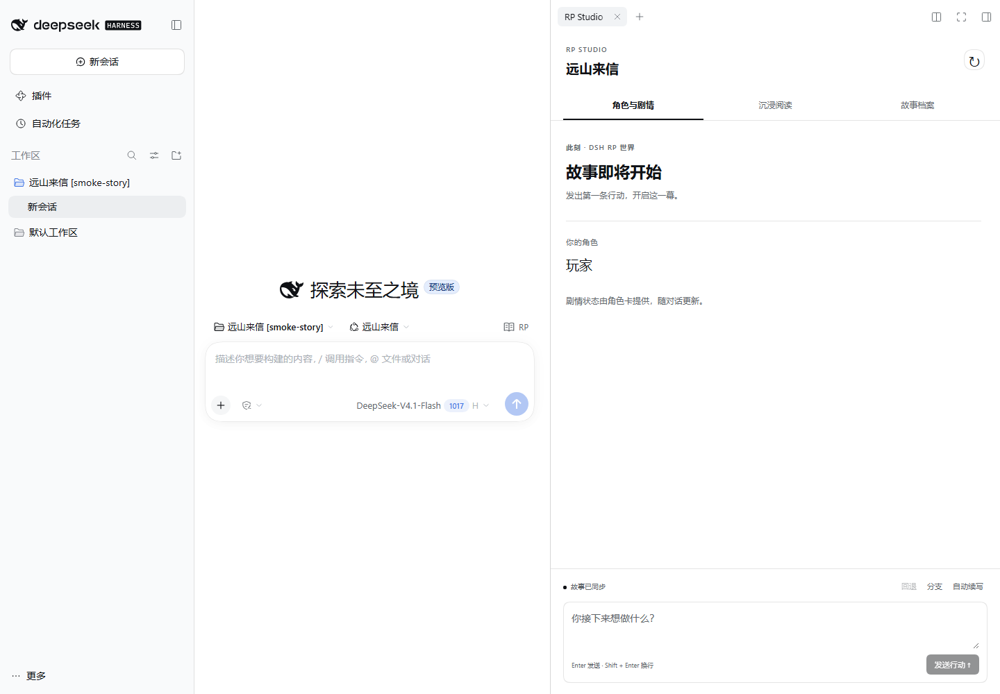
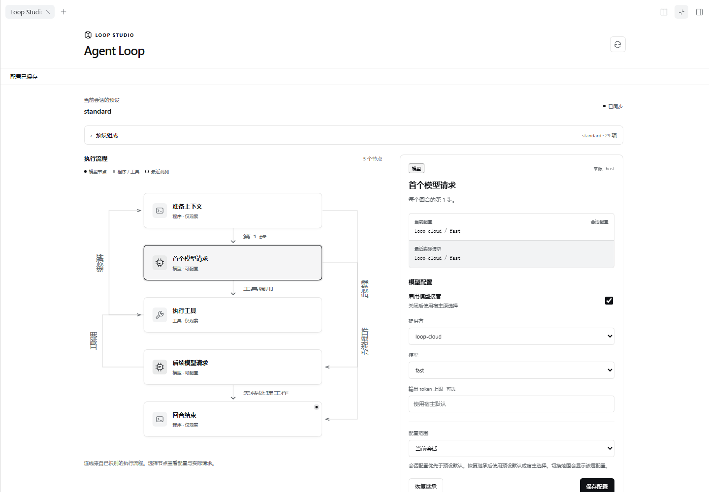

# DSH RP Studio

DSH 0.2.1-rc.2 内置角色扮演工作区。点击会话顶部的 **RP** 打开右侧页签；空白会话中，RP 位于输入区上方。工作区可以拉宽、全屏阅读或关闭，使用 dsh 本身的主题和会话导航。

## 项目与下载

| 独立项目 | 职责 | 安装包 |
| --- | --- | --- |
| **RP Studio（本仓库）** | 原生故事阅读、角色状态、故事档案 | [v1.2.0](https://github.com/LiweiDonVee/dsh-rp-studio/releases/tag/v1.2.0) |
| [Loop Studio](https://github.com/LiweiDonVee/dsh-loop-studio) | 通用执行图、节点模型选择 | [Releases](https://github.com/LiweiDonVee/dsh-loop-studio/releases/latest) |
| [RP 最后一步](https://github.com/LiweiDonVee/dsh-rp-last-step) | ST 预设迁移、模块热组装、最终正文 | [Releases](https://github.com/LiweiDonVee/dsh-rp-last-step/releases/latest) |

三个项目可独立安装；需要完整 RP 联动时，把三个包安装到同一个 DSH profile。新插件的主仓库、独立构建和问题跟踪已迁至上表对应项目。本仓库保留 `packages/loop-plugin`、`packages/rp-last-step` 和迁移 skill 的已验证集成快照，供联合回归使用；它们的后续开发和正式发布以独立仓库为准。

[原生使用指南](docs/native-usage.md) · [更新记录](CHANGELOG.md) · [最后一步联动验收](docs/rp-last-step-acceptance.md)

- **角色与剧情**：场景、角色状态、目标、关系、任务、物品与记忆。
- **沉浸阅读**：玩家与 GM 对话、流式回复、发送行动、停止生成、回退、分支和自动续写。
- **故事档案**：选择已安装的 RP 角色预设开始故事，或继续已有旅程。

原生插件直接使用宿主进程内的 Remote 接口及经过认证的 Connection 路由，不另起服务，不需要复制 token。模型选择、权限审批与数据持久化沿用 dsh；公开状态和叙事仍经过原有过滤，不把 reasoning、tool result 或私有剧情字段发给工作区。



## 通用 Agent Loop 插件

独立的 [DSH Loop Studio](https://github.com/LiweiDonVee/dsh-loop-studio) 适用于任意 dsh 预设的组成分析及内置 agent-loop 执行图。支持为首个模型请求、工具后的后续请求和接入的模型阶段单独配置 provider/model，保存会话覆盖或预设默认；无需安装 RP Studio。第一版保持宿主执行顺序，图内核与适配器分离，为后续可编辑流程保留边界。



独立构建与使用说明见 [Loop Studio 文档](https://github.com/LiweiDonVee/dsh-loop-studio/tree/main/docs)。本仓库的 `pnpm loop:package`、`pnpm loop:smoke` 针对保留的集成快照。

## RP 最后一步

独立的 [dsh-rp-last-step](https://github.com/LiweiDonVee/dsh-rp-last-step) 负责 **SillyTavern 预设迁移 → 模块热组装 → 最终正文**。现有 agent 和工具继续处理模拟、判定与状态；正文模型只接收公开事实和呈现模块。

导入原件独立保存，迁移 skill 生成待审阅的 agent 范式草稿。用户可指定必用、Agent 只读模块；模型按需读取、启停、填充和改写其余模块，变化只进入会话覆盖层。故事固定到所选预设版本，保存新版本不会自动替换正在使用的版本。

插件自带原生预设编辑器和已提交稿件记录，可单独安装。配合 RP Studio 1.2 可在故事页管理预设、流式阅读正文；配合 Loop Studio 可分别给迁移、热组装和写作选择模型。三个包互相独立，不要求同时安装。第一版终止呈现需要原生工具模式，纯 PTC 会话仍可迁移、编辑和预览。

安装包：`dsh-rp-last-step-0.1.0.tgz`，从其 [Releases](https://github.com/LiweiDonVee/dsh-rp-last-step/releases/latest) 下载。安装方式同下，将包名替换即可。源码构建与迁移 skill 见 [独立仓库](https://github.com/LiweiDonVee/dsh-rp-last-step)。本仓库的 `pnpm rp:package`、`pnpm rp:smoke` 针对集成快照，历史验收见 [记录](docs/rp-last-step-acceptance.md)。

## 安装原生插件（推荐）

从 [v1.2.0 发布页](https://github.com/LiweiDonVee/dsh-rp-studio/releases/tag/v1.2.0) 下载 `dsh-rp-studio-1.2.0.tgz`，完全退出 dsh 后执行：

```powershell
dsh plugin --profile desktop add ./dsh-rp-studio-1.2.0.tgz
```

重新启动 dsh 即可。Web 模式将 `desktop` 换为 `web`。也可以通过右侧面板的新增页签导航找到 **RP Studio**。插件不附带角色卡；RP 预设仍需单独安装。具体说明见 [插件文档](packages/plugin/README.md)。

发布页附 `SHA256SUMS.txt`，可用 `Get-FileHash ./dsh-rp-studio-1.2.0.tgz -Algorithm SHA256` 核对。Windows 找不到 `dsh` 命令时，默认安装可执行：

```powershell
$dshCli = Join-Path $env:LOCALAPPDATA 'Programs/DeepSeek Harness/resources/runtime/cli/bin/dsh.cmd'
& $dshCli plugin --profile desktop add ./dsh-rp-studio-1.2.0.tgz
```

源码构建：Node 24、pnpm 11，执行 `pnpm install` 与 `pnpm plugin:package`。安装包生成在 `packages/plugin/artifacts/`。仅构建原生插件时，若不需要下载旧 Electron 客户端，可以在安装依赖前设置 `ELECTRON_SKIP_BINARY_DOWNLOAD=1`。

下文保留独立客户端及其 Gateway 的使用说明，作为已有用户的兼容入口。

## 档案

Studio 不附带私有角色卡。新安装的隔离 DSH home 可以没有可玩卡和会话；测试中的 `sample-world` 只是合成 fixture。`rp-runtime` 基础模板不出现在新建列表，仅用于恢复已存历史会话和派生新卡。

档案从 DSH roster 读取可用预设，按可读取的 RP bundle 元数据或受支持的 `rp-runtime`、`rp-context-runtime` 等运行时标记识别。无效、损坏或不可读取的条目不显示，`template` 不进入新建故事列表；基础模板仍可保留供已有会话恢复。新版原生路径不要求 Studio 自行扫描本地 `rp-card.json`。

## 独立客户端与 Gateway

本次 v1.2.0 发布提供原生插件。历史独立客户端保留源码，Windows portable 的构建输出位于 `apps/desktop/artifacts/`。它内置 Gateway/Web 构建资源，自动发现本机官方 DSH 启动器和独立 Node 24，并将用户数据保存在 Electron `userData`；不会在 portable 内捆绑或替代官方 DSH。构建旧客户端需要另外安装 Electron 二进制。

开发环境可运行 `pnpm start:stack`：使用官方 DSH 0.2.0-rc.2 Web profile，启动 DSH Web 与 Studio，并在进程内自动交换认证 token。先运行 `pnpm build`。默认 DSH home 位于项目忽略的 `.runtime/dsh-home`，`DSH_RUNTIME_ROOT` 可覆盖官方安装目录，`DSH_HOME` 可指定隔离测试目录，`DSH_PORT` / `DSH_RP_PORT` 可调整端口。已有服务占用端口时不会关闭其他进程。

开发构建要求 Node.js 24 和 pnpm 11；portable 运行使用官方 DSH 自带的独立 Node，不要求单独启动 3080/3091 服务。Supervisor 在 loopback 上为 DSH/Gateway 分配端口。可选叙事方法由配置的 DSH Web profile 提供，缺失时仅禁用方法面板。

原生插件的验证目标为 **DSH 0.2.1-rc.2**；独立客户端的运行时发现同时接受 0.2.0-rc.2 与 0.2.1-rc.2。Gateway 使用 Remote RPC、`remote.mux`、`session/follow` 和 `session/page`；旧版 `ApiProxy` 的点号 RPC 已不再支持。详细接口与版本边界见 [DSH 兼容说明](docs/dsh-compatibility.md)。

DSH Web 的 HTTP API 和 WebSocket 在 loopback 上也需要认证。先启动相应 DSH Web profile，将其启动 URL 中 `token` 的值设为 Gateway 进程环境变量（下面为占位示例）：

```powershell
$env:DSH_WEB_TOKEN = '<3080 启动 URL 的 token>'
$env:PROMPT_PRESETS_WEB_TOKEN = '<3091 启动 URL 的 token>'
```

Gateway 在服务端以启动 token 换取 cookie，并在 HTTP/WebSocket 中复用；token/cookie 不进入浏览器或公开协议。`.env.example` 是配置示例，启动脚本不会自动加载 `.env`。DSH 重启后若认证失效，更新对应 token 并重启 Gateway。不要将 token 写入 `VITE_*` 变量或提交到仓库。

```powershell
Set-Location ./dsh-rp-studio
.\scripts\install.ps1
.\scripts\start.ps1
```

默认地址：<http://127.0.0.1:4317>。启动脚本仅绑定 loopback；若首选端口被其他程序占用，会在随后 20 个端口中选择可用端口。已有 Studio 占用首选端口时，脚本直接报告现有地址。

可用 `-DshPort`、`-PromptPresetsPort` 和 `-Port` 分别覆盖三个 loopback 端口。所有会话的可选叙事方法默认关闭；空白配置会在“方法”页提示，修改从下一轮生效。

开发启动脚本默认使用隔离的 DSH home，不会读取、复制或修改用户默认 `~/.dsh/sessions`。私有预设和卡片仍由其所有者单独安装；已安装的原生插件则读取当前宿主授权的会话。

## 验证

```powershell
pnpm verify
pnpm smoke:real
```

`pnpm verify` 执行零 warning lint、workspace typecheck、单元测试、生产构建和 Playwright。浏览器验收覆盖 SSE 流式输出、取消、连续回退、分支、自动续跑启停、刷新恢复、卡片切换、移动 sheet、四个目标视口、secret canary 扫描与 axe 无障碍检查。`pnpm smoke:real` 只读检查真实 DSH 和生产页面，不会发送模型 prompt。

`smoke:real` 的 HTTP 请求只使用读取接口，但 DSH 的 `session/follow` 可能激活冷会话并由 DSH 执行日志升级；需要绝对不触碰历史文件时，请使用隔离的 DSH home。Studio 自身不会直接打开或改写线上 Session 日志。

## API

公开协议位于 `/api/v1`：

- `GET /health`, `/cards`, `/sessions`, `/sessions/:id`
- `POST /sessions`, `/sessions/:id/messages`, `/cancel`, `/rollback`, `/fork`
- `PUT /sessions/:id/autoplay`
- `GET`, `PUT`, `DELETE /sessions/:id/prompt-presets`
- `GET /sessions/:id/events`（SSE）

早期本地客户端使用的 `/prompt`、`/stream` 和 `POST /autoplay` 仍作为兼容入口保留。
