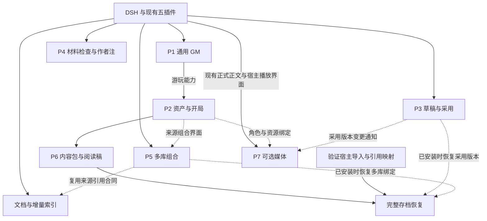

# Agent RP 项目组合规划

独立规划：Astra XHigh · 2026-10-25

**状态：提案，尚未实现。** 本文用于讨论与立项，不代表创建仓库或开始开发。所有新仓库、接口名称和版本安排均为建议。

## 一、总体判断

建议分为 **7 个项目，近期新增 2 个插件仓库**：通用 GM 与故事资产。正文草稿、材料检查、多库与文档索引扩展现有插件；迁移导出归故事资产体系；媒体有明确需求后再增加第 3 个可选插件。

必须先补的空缺，是**正式可用的通用 GM 与从内容到开局的入口**。现有五插件已经把阅读、模型路由、资料、上下文和正文接起来，但没有已发布、验收过的通用 GM。集成测试中的合成故事和事实工具不能算产品运行时。旧 RP preset、恢复代码和造卡工厂有参考价值，尚不能作为已发布依赖。

最小全栈不要求所有故事都有数值系统；它要求用户能开始故事、行动、持久化事实、阅读、继续、恢复和回退。当前最值得投入的是这条闭环，然后是改稿和创作操作。

## 二、现有阵列继续负责什么

| 组件 | 已有职责 | 本规划中的定位 |
|---|---|---|
| RP Studio 1.2.0 | 原生工作台、阅读、故事导航、回退与分支 | 各项目的统一游玩入口，不另造独立客户端 |
| Loop Studio 0.1.0 | 已支持阶段的真实模型路由与执行元数据 | 继续配置模型，不扩成自由拓扑执行器 |
| Database 0.1.1 | 源库版本、单库绑定、因果覆盖、人类策略、ST 世界书 JSON 与检索 | 唯一故事资料存储，扩展多库和文档 |
| Context 0.1.0 | 最近正文／真实摘要／索引，中间模型主动选材 | 材料准备层，作用于自身 GM 与 writer 输入 |
| Last Step 0.2.0 | 预设迁移、模块锁与热组装、隔离 writer、冻结失败重试 | 正文与稿件生命周期的所有者 |
| DSH 宿主 | Agent 循环、工具、模型、原生界面、认证、会话生命周期 | 继续复用，不再造网关、凭据库或分支引擎 |

人物知情继续采用自由文本备注，由 GM 判断；人类只读、必开、禁用继续由程序执行。原始来源不被会话覆盖回写，不把提示词、计划、临时备注和已发生事实混成一类。

## 三、项目组合与实施顺序

| 项目 | 仓库归属 | 用户得到什么 | 分类／顺序 |
|---|---|---|---|
| P1 通用 GM 运行协议 | **新建提案：dsh-rp-gm** | 安装后就能运行普通文本故事 | 闭环必须／第一批先做 |
| P2 故事资产与开局 | **新建提案：dsh-rp-story-kit** | 导入角色卡，选玩家身份、开场，一键开始 | 面向普通用户的闭环必须／第一批随后 |
| P3 正文草稿与采用 | Last Step 主导，Context、Studio 配套 | 重试按钮、候选稿、编辑、比较和采用 | 创作增强／第二批 |
| P4 材料检查与作者注 | Context 主导，Last Step、Studio 配套 | 查看本轮实际材料，设置一次性写作指导 | 创作增强／第二批 |
| P5 组合资料与文档索引 | Database 主导，Context、Story Kit 配套 | 多库组合、文件资料检索、增量索引 | 资料增强／第三批起 |
| P6 内容包与故事迁移 | Story Kit、Studio 与各数据所有者 | 分享内容包和阅读稿，逐步支持恢复故事 | 交付增强／第三批起，完整恢复后续 |
| P7 媒体演出 | **可选新建提案：dsh-rp-media** | 朗读、角色资源与后续媒体呈现 | 有需求再立项 |

P3、P4没有互相阻塞的硬依赖，可以按人力独立排期。P5、P6各分两次交付，不要求先实现全部远期能力。

## 四、P1：通用 GM 运行协议

### 归属与价值

建议独立插件，而非资产编辑器里的隐含运行时。主 GM 应能处理原创内容、ST 迁移内容或手工资料；资产格式不应决定事实提交和世界推进方式。资产插件也不应拥有正在运行的世界状态。

插件复用 DSH 标准原生 Agent。若宿主创建会话必须指定 preset，可提供**一个所有故事共用的通用配置入口**，只完成工具与协议接线；卡数据通过绑定传入。绝不为每张卡生成 preset、插件代码或单独运行目录。

### MVP

1. 通用开局与回合协议：读取需要的资料、理解玩家行动、判断结果、提交变化、进入现有最后一步。
2. 轻量回合提交工具，接受一批 Database 操作和已确定结果说明；检查会话、revision、人类策略与当前来源，返回稳定的提交引用。
3. 少量可展示状态约定：当前场景、在场人物引用、玩家身份、必要的物品/关系变化和近期事实。只有故事实际使用的字段才维护，不默认生成任务、经济、战斗系统。
4. 一个公开小故事，支持重启、回退、分支与冻结正文失败重试。
5. Studio 明确认识这种通用故事和状态来源，继续兼容已有旧故事。

### 两种 GM 的归属必须清楚

- **主 Agent／通用 GM**负责世界推进和事实裁定。自然语言故事由它判断；有明确规则工具时采用工具结果。
- **Context 中间模型**负责材料准备：检索、排序、展开／折叠历史、维护工作资料和临时备注。它不成为第二个事实裁判。

权威状态仍保存在 Database，不另建第二份人物/世界真值。最小做法是在故事绑定里登记少量 `factEntryRefs`，表示本故事由主 GM 提交管理的状态条目。Database 的人类策略对所有阶段继续有效。

通用 GM 启用时，Context 对这些状态引用只读；它仍可修改其他允许的资料与备注。新增条目默认是工作资料，不能由中间模型自行标记为已确认权威状态。阶段写范围由程序服务执行，模型不能自行扩大；这是防止两层互相覆盖的写入约定，不是 NPC 知识 ACL。未启用通用 GM 的原有 Database/Context 用法保持兼容。

本轮提交顺序为：**主 GM 处理结果→一次提交必要状态→取得接受结果→Context 准备材料→Last Step 写正文**。writer 失败不撤销已经完成的事实，也不允许重试再次提交；重写复用同一事实引用和冻结材料。人类要改行动或结果时，走回退／分支再处理。Context 若发现事实需要改判，应返回明确诊断或待处理备注，不在后置选材中悄悄改掉它。

上述 factEntryRefs、阶段写入范围、稳定事实提交回执都是 **P1 新接入时需要实现的建议合同**，不是 Database 0.1.1 已有能力。现有 Database 提供的是条目权限、revision 和因果覆盖，不能把它的普通 patch 响应直接宣传成已完成的结算协议。

程序可以校验结构、版本、权限和重复提交；不能证明任意自然语言结果符合所有世界逻辑。这部分必须通过真实模型试玩检验，不用“权威状态”一词制造语义保证。

### 依赖／主要接口

复用 DSH create/prompt/cancel/fork、Database effective/read/search/patch、Context.prepare 和 rp_present。拟议 `rpGM.startStory`、`rpGM.storyState` 与回合提交服务只表达职责，最终名称按实现确定。事务落在现有 Database 批次与规范工具结果中，不引入跨服务事务平台。

### 验收与不做项

干净安装启动公共故事，完成一次事实变化；失败正文仅重试 writer；重启后状态相同；父子分支独立；回退恢复原状态。所有操作通过原生界面或正常行动完成，不能依赖测试 fixture。

不做通用 RPG 引擎、数值公式 DSL、全世界离屏模拟、每 NPC 多 Agent、认知 ACL、自由 graph。旧 runtime 的来源与回退经验可借鉴，未恢复/未适配代码不能直接成为运行依赖。

## 五、P2：故事资产与开局

### MVP与用户体验

在原生可拉出资产面板中：

- 导入 Character Card v2/v3 JSON，以及常见 PNG 的 chara/ccv3 元数据；保留原件、头像和来源。
- 管理姓名、描述、性格、场景、first_mes、alternate_greetings、示例对话、作者与标签；嵌入世界书复用 Database 现有导入器。
- 保存轻量 persona：名字、描述、头像。开局明确选择并固定，不改写旧消息身份。
- 审阅迁移映射：哪些是资料、开场、语气示例、待适配指令。ST 指令通过现有迁移草稿审阅，不能因导入卡片就自动获得高权限。
- 选择角色版本、persona、开场、单个来源库和就绪文风版本，点击开始。
- 提供相同的原创内容编辑入口和配套迁移/创作 skill；不必要求作者先制造 ST 文件。

Story Kit 拥有原始资产、版本和组合配置；Database 拥有检索资料及会话变化；Last Step 拥有文风模块。通过引用关联，不让多个插件各自编辑同一份人物真值。

### 边界与依赖

P1 是游玩依赖；没有 GM 时仍能导入和编辑资产，但不能显示为已可玩。第一版使用单角色资产和现有单库，persona 与所选开场作为小型固定故事配置传入。多库交给 P5，不将多个源库永久压成无来源的 JSON。

开局先校验引用与依赖，再创建会话和绑定；绑定完成前不发送第一轮请求。部分失败保留待完成开局，用同一启动标识继续，避免重复会话/开场。

示例对话只是语气示例，未选开场不是事实。若直接展示作者原开场，必须通过合法的正式开局记录让 Context 和 Studio 同时识别；不能只显示文本却不进入故事来源，也不能伪造旧 rp_present 调用。

### 验收／明确不做

自制公开 PNG 卡含两个开场、示例和世界书：导入→审阅→选 persona 与第二开场→游玩三轮→重启继续。未选开场和示例不会被当作已发生历史；修改源卡不改变旧故事；新故事互不影响。

不做任意 ZIP/APNG、STscript/TH 执行、每卡 runtime、复杂多人聊天室。后续人物阵容和点名发言仍由单一 GM 组织，不要求独立 NPC Agent。

## 六、P3：正文草稿与采用

归属：**Last Step 管稿件，Context 管有效历史，Studio 管操作**，不新建仓库。

### MVP

- 在失败稿处提供“只重试正文”按钮，复用已验证能力。
- 对最后一轮成功正文生成同事实候选稿，或手工编辑候选；比较后采用。
- 首次成功正文仍默认自动采用，不强迫每轮人工审稿。
- 第一版只支持没有后续叙事依赖的末轮改稿；更早内容引导创建分支。
- 候选有独立 ID，正式叙事有采用版本；未采用内容不进入摘要、下轮上下文或自动朗读。

### 依赖／接口

复用冻结材料和 writer，拟议 createDraft/editDraft/adoptDraft；不重跑事实工具、Context 选材或数据库提交。采用记录需要通过宿主支持的规范更正／替换路径，使主 Agent、Context 与阅读器一致识别当前稿，不能只有 UI 换字而后续上下文仍认为旧稿有效。

手工编辑不能由程序证明“事实完全不变”。界面明确区分改表达与改行动/事实；后一种使用回退分支，不加入强制复核模型。

### 验收／不做

同一结果生成两稿→采用第二稿→事实提交次数仍为一次→下轮和摘要使用第二稿→重启一致→分支采用互不干扰。若已经产生下一轮，不可直接采用旧候选。

不做无限自动采样、词级概率编辑、任意历史自动重算。成功稿候选与失败重试分开，不放宽原失败重试资格。

## 七、P4：实际材料检查与作者注

归属：**Context＋Last Step，Studio 提供入口**。Loop 保持元数据路由工具，不承担正文存储。

### MVP

- 原生面板查看本次实际冻结的方向包、条目版本/来源/顺序、历史表示、未决事项、文风模块、实际模型和材料规模。
- 对照候选与最终选中，展示已有评分与明确选择；不声称展示模型未输出的推理。
- 一个“下一轮写作指导”入口，用于视角、节奏、强调内容；显示待使用／已冻结状态。失败重试沿用同一指导，下一事实回合不意外复用。
- 从材料跳转到数据库条目或正式历史；字符数与真实报告的 token 分开标记。

### 依赖／验收／不做

复用 contextPreparation、compiled receipt 和授权 owner 接口，读取真实快照，不用最新数据库重造一个冒充过去请求的预览。

验收：生成后修改数据库，旧轮检查器仍显示原始输入；下一轮使用新版本；一次性指导及取消/重试生命周期可解释。

不做任意深度注入、运行中修改冻结请求、推理链窥视、另一个提示词编译器。作者注不赋予修改人类锁或事实的权限。

## 八、P5：组合资料与文档索引

归属：**Database 一个项目、两次交付**；Context 更新消费合同，Story Kit 提供组合入口。

### M1 多库组合

来源绑定扩展为有序的版本引用列表，兼容旧单库。每条引用带 source/entry/version，相同 ID 不互相覆盖。支持共享世界、人物资料、本故事补充；Agent 不能更换人类来源、版本或策略。同名资料保留各自来源，优先顺序不自动决定事实真伪。

覆盖仍属于会话，fork/rollback 维持因果来源。更换组合先展示影响，不静默重置旧覆盖。

验收：两库都有 id=1，读取和更新均命中正确来源；禁用内容不能绕过；父子故事独立；旧单库故事继续工作。

### M2 文件入口与可重建索引

首批 TXT、Markdown、有文本层 PDF；提取预览、原文件保存、片段与页/段落定位。原文件不被 Agent 改写，资料也不因解析成功变成故事事实。

持久向量索引按内容版本、切块策略和 embedding 模型标识建立；只重算变化内容，换模型明确重建。索引是派生数据，检索仍过滤当前分支/禁用状态。保持现有关键词降级和显式提供方配置。

验收：导入短 PDF→找到非首段并显示来源→重复查询不重新向量化全文→修改或禁用后旧片段退出→重启可复用或重建索引。

不做外部向量集群、爬虫平台、自动联网、Office 全格式或 OCR。只有实际资料规模需要时提前 M2；不因 ST 有 Data Bank 就先建大型数据平台。

## 九、P6：内容包与故事迁移

归属：**Story Kit 管内容包，Studio 管故事导出，各插件导出自己的数据**。不新建迁移仓库。

### M1 内容与阅读稿

内容包包含角色/persona/开场、来源库版本、文风 profile、资源与能力依赖；不携带脚本执行能力、模型密钥或作者账号配置。接收者导入后看诊断并选择自己的模型。

阅读稿导出当前分支正式采用的 Markdown/TXT；不夹候选、过程文本和整个数据库。ST 世界书导回可作为格式适配子项，明确可往返字段，不宣称复原所有高级激活语义。

验收：第二个干净环境导入内容包→原件/策略正确→选择模型→开启全新故事；阅读稿只含有效正文。这叫内容迁移，不叫原存档恢复。

### M2 完整存档恢复：先验证宿主接口

当前没有证据证明宿主提供保留 sourceEventSeqs 并返回映射的公开跨 home 导入 API。先验证合法的导入/恢复和引用映射，再承诺此里程碑。

完整恢复需重接 Session/事件/消息/稿件引用、插件绑定与因果覆盖，并在一个稳定故事状态上捕获数据；分别复制几个正在变化的插件 JSON 不算完成。

验收：A 环境游玩分支→导出→B 环境恢复→继续→回退到导入前前缀→Database、Context 和采用稿投影仍一致。若宿主缺能力，先保留 M1，针对缺口做窄适配；不修改私有日志或伪造历史兑现恢复宣传。

## 十、P7：可选媒体演出

新仓库提案：**dsh-rp-media**。媒体提供方、缓存和播放生命周期不应成为文本 RP 的强制依赖，因此独立插件合理。

MVP先做已定稿正文朗读：手动播放、暂停、停止、队列、一个明确支持的 TTS 适配器，可选简单角色声线。Studio 提供播放槽，Story Kit 提供人物资源，Last Step 提供正式稿版本。

验收：播放指定正文→停止立即生效→切换故事不串音→未采用草稿不自动朗读→换稿或换分支后绑定正确→卸载媒体不影响文本 RP。

不做实时语音、声纹克隆、自动全量出图、Live2D/VRM 或复杂导演系统。立绘、背景音、插画以后按明确需求逐项加入；不能把宿主能调用图像工具当作已具备完整 RP 多媒体流程。

## 十一、规则包、世界推进与旧资产

P1先提供自然语言 GM 裁定和可靠事实提交，满足普通文本故事。对于确实需要随机检定、战斗、资源或日程的故事，再立一个窄规则包项目；拟名如 `dsh-rp-rules-basic` 也只是候选，不属于首批仓库承诺。

规则包拥有其规则结果，状态仍通过 Database/通用回合合同持久化。Story Kit 标明故事依赖的能力；没有所需规则插件时显示待适配，不以自由叙述冒充严格规则实现。

旧 runtime 的状态/回退、Card IR 的来源分类和迁移审计可分别进入 P1/P2；缺损文件、旧环境假设和未验收行为不能直接升级为产品基础。背景考据 skill 仍负责作者研究，其成果经采纳再进入资料；不额外造一个研究型记忆引擎。

## 十二、依赖路线

图中实线表示功能基础或硬依赖，虚线表示配套整合；实施优先级以下方批次为准。

- 第一批：P1→P2；共用 story binding 合同，但分别交付。P2不等多库、媒体、索引或完整恢复。
- 第二批：P3与P4；先补重试按钮和实际材料查看，再完成采用与指导生命周期。
- 第三批：P5 M1与P6 M1，解决来源复用与分享。
- 后续：据真实资料规模和玩法选 P5 M2、P6 M2、媒体或窄规则包。

只定义当前需要的版本化引用：StoryBinding、EntryRef、FactReceipt、PreparationRef、NarrativeRef/采用版本。由拥有数据的插件提供服务，不先建共享 SDK 仓库或总线。

## 十三、首批两个端到端例子

### P1：从空安装玩“雨夜驿站”

合成故事只有旅人、店主、信使和一封信，没有战斗数值。通过通用入口开始，玩家说“把信交给店主”。主 GM 读取资料并一次提交持有人变化，材料模型选材，writer 写正文。下一轮询问信在哪，答案与 Database 一致。

令 writer 故意失败后仅重试正文，信不会重复转交。从转交前分支，子故事仍由玩家持信，父故事保持店主持有；重启后两者各自恢复。如果这条过程仍需开发者运行 fixture，P1就没有完成。

### P2：从 PNG 卡开始自己的故事

导入自制“驿站店主”PNG，含两个开场、例句和世界书。选择 persona“过路信使”和第二开场，审阅文风后点击开始。后续模型能延续所选开场，但不会把第一开场或例句当成发生过的事。

退出重开仍维持角色、persona与版本；源卡升级不改变旧故事，新故事可选新版。随后用真实模型连续试玩20—30轮，观察人物声音、承诺回收、玩家自主权和回退一致性；程序 smoke 与真实体验分别记录，不互相冒充。

## 十四、阶段出口与已知接口不确定性

P1＋P2的出口：普通用户不写代码、不制作运行 preset，就能导入普通卡、开局、持续游玩、重启、回退与分支。达到后可称为面向普通用户的最小文本 Agent RP 产品。

P3的出口：采用稿、事实状态、主 GM 与后续材料一致。P5的出口：来源和索引不会复活失效分支。P6完整恢复的出口：换环境后仍能正确回退重放。界面出现或工具注册不等于这些闭环完成。

开工时只需先做几个窄接口验证：通用会话/开场的合法注册与来源；末轮采用的规范更正路径；完整存档导入与引用映射。这些不改变前两项优先级，也不应演变成再设计整个宿主。

## 参考

- [现有 SillyTavern 对照报告](https://github.com/LiweiDonVee/dsh-rp-database/blob/main/docs/sillytavern-comparison.md)
- [RP Studio](https://github.com/LiweiDonVee/dsh-rp-studio)
- [Loop Studio](https://github.com/LiweiDonVee/dsh-loop-studio)
- [Database 架构](https://github.com/LiweiDonVee/dsh-rp-database/blob/main/docs/architecture.md)
- [Context 架构](https://github.com/LiweiDonVee/dsh-rp-context/blob/main/docs/architecture.md)
- [Last Step 架构](https://github.com/LiweiDonVee/dsh-rp-last-step/blob/main/docs/architecture.md)

本文没有附带私人角色内容、历史技能正文或环境配置。新增项目均为规划提案，后续以用户选定的项目范围开展实现。
