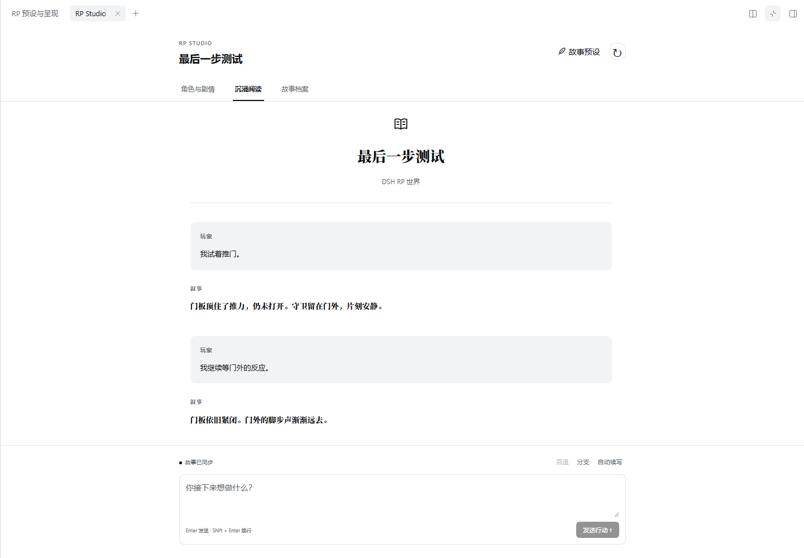
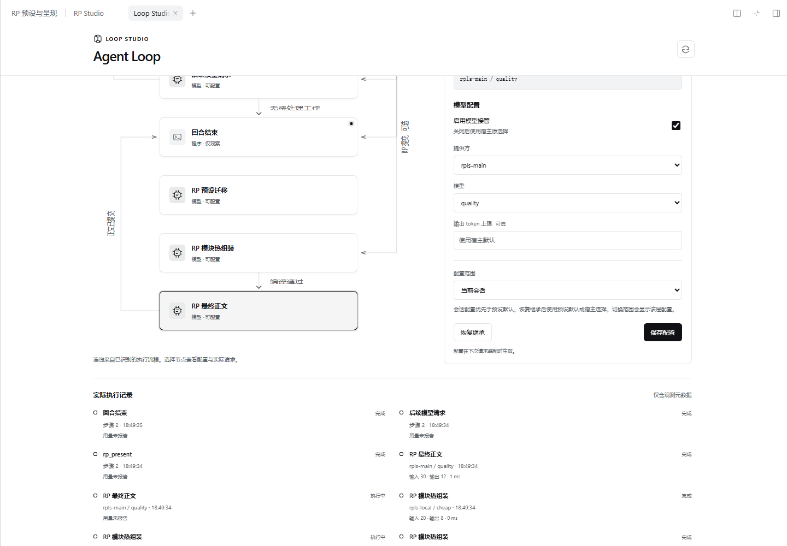

# RP 最后一步 0.1 / RP Studio 1.2 验收

本文件记录拆仓前的集成快照。独立项目及正式发布包的验证记录、下载和校验值见 [RP 最后一步](https://github.com/LiweiDonVee/dsh-rp-last-step)、[Loop Studio](https://github.com/LiweiDonVee/dsh-loop-studio) 和各自 Releases；下方历史哈希对应当时受测快照。

2026-10-24（Asia/Shanghai）。官方 DSH 0.2.1-rc.2，Node 24，独立临时 home，合成预设、事实工具和模拟模型。现有用户资料未参与验收，没有付费模型请求。

交付包含独立 `dsh-rp-last-step` 0.1.0 和 RP Studio 1.2.0 联动。Loop Studio 0.1.0 是已独立交付的通用组件；RP 通过可选阶段接口接入，不与图插件互相依赖。事实、模拟和结算继续由既有 agent／工具负责。

| 检查 | 结果 |
| --- | --- |
| 整仓单元测试 | 470/470，其中 RP 运行时 89、预设编辑器 21、领域转录 36、Gateway 106、原生插件 10 |
| 类型检查、生产构建、零 warning lint | 通过 |
| 构建输出清理契约 | 1/1 |
| 现有浏览器 E2E | 11/11，含阅读、取消、回退、分支、移动布局、secret canary 和 axe 检查 |
| ST 迁移 skill | 结构校验通过；职责拆分、锁冲突、默认启停的独立演练见 [记录](skill-evaluations/2026-10-24-st-rp-migration.md) |
| RP Studio 单独安装 | tgz 安装、原生入口、故事创建、档案导航、全屏、520px、关闭重开通过 |
| RP 最后一步单独安装 | 无 Loop/Studio 包；导入、迁移、编辑器、两次终止呈现和已提交稿件记录通过；阶段继承会话模型 |
| 三个插件共同安装 | 三个实际节点分别调用 local/migrate、local/cheap、main/quality；Loop 原生模型控件显示相应路由 |
| 原件和策略 | 导入文本逐字保留；默认关闭保留；只读模块修改被拒绝，随后允许文风填充成功；会话覆盖不改变原件 |
| 主 Agent / 正文隔离 | 主 Agent 只有 Agent/shared 模块；正文无主历史、世界私有值、Agent 模块或工具，分块 thought 标签未进入正文流 |
| 终止和规范回放 | 两次行动各执行一次事实工具；成功后不再主模型复述；复用 provider 工具 ID 仍保留两条正文 |
| 未绑定会话和模型选择 | 未绑定会话的实际原生注册表与模型 schemas 均无 RP 工具；迁移尊重刚选择的本地模型，优先于旧请求头 |
| 原生显示 | 安全正文流、已确认正文、预设侧栏、全屏、窄窗口和 Loop 节点检查通过，无浏览器运行错误 |
| 独立代码复核 | 锁定填充、迁移模型选择、ST 语义元数据和报告恢复问题修复；定向复核无剩余发现 |
| 旧独立客户端集成检查 | 11/12；本机未下载旧 Electron 可执行文件，工具链 doctor 一项失败 |

程序回归还覆盖：只读填充值不能被方向包变量覆盖；必用模块不能禁用或编译为空；全局 revision 与预设版本冲突；原生/PTC 作用域；装配期间绑定快照；取消、失败和重复提交；卸载清理；冷会话模型选择；坏的保留上下文标记；回退以及规范 `sourceEventSeqs` 调用关联。它们不全部属于真实宿主浏览器场景。

## 可复验命令

```powershell
pnpm test
pnpm lint
pnpm typecheck
pnpm build
node --test scripts/*.test.mjs
pnpm plugin:package
pnpm rp:package
pnpm plugin:smoke
pnpm rp:smoke
pnpm rp:smoke -- --standalone
```

原生 smoke 需要已安装的官方 DSH 及 Playwright Chromium。可用 `DSH_BIN` 指定启动器，`PLAYWRIGHT_CHROMIUM_EXECUTABLE_PATH` 指定现有浏览器。本次既有 E2E 使用相同测试配置及浏览器可执行路径覆盖；不改变测试内容。

`.runtime/rp-step-evidence/acceptance.json` 和 `.runtime/rp-step-alone-evidence/acceptance.json` 记录受测 RP 包哈希及结果。自包含包不依赖源码工作区：

| 包 | SHA256 |
| --- | --- |
| dsh-rp-last-step-0.1.0.tgz | `1d452b210349c89867ddb036788e5a5c3b47143e880835d8c5c473802e2399ab` |
| dsh-rp-studio-1.2.0.tgz | `adfb5c1018988ef4a09515b89cac95b70f4366e6e3c4a2011dd20965c7f1a1c6` |
| dsh-loop-studio-0.1.0.tgz | `3796a681774f61f0b3731f576e02fa7d783c6348ead12cff139b32cd30f84ae8` |

## 界面






## 当前边界

终止呈现支持原生工具模式；纯 PTC 会话可迁移、编辑、预览，启用时会得到明确错误。旧 RP 预设若有专属末端命令，需要把末端工作流适配为 `rp_present`。插件不提供模拟或结算引擎。

正文模型收到的事实由调用方选择。模拟验收证明实际调用、数据边界和界面流程，不能证明真实模型必然正确迁移任意预设或完全遵守事实；迁移结果始终保留人工审阅步骤。没有测试真实模型质量、服务价格或延迟。

独立生成记录页是已提交稿件档案，当前剧情分支以 RP Studio 回放为准。原生 Studio 接收安全正文流；旧独立客户端等待规范完成结果。生成中重新连接的部分草稿追赶、专用正文重试按钮、可选复核模型及自由编辑执行拓扑未纳入本版交付。
